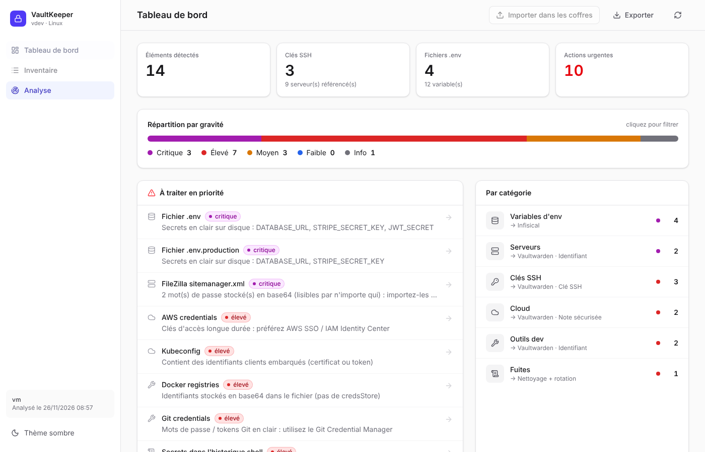
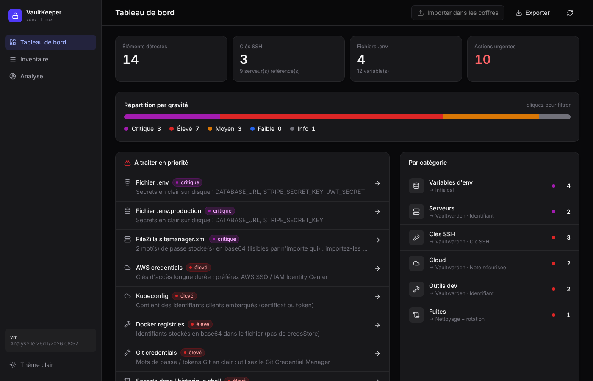

# 🔐 VaultKeeper

**Retrouver, protéger et partager tous les secrets DevOps d'une équipe** : clés SSH,
accès serveurs, mots de passe, variables d'environnement, identifiants cloud.

- Plus de clés SSH qui n'existent que sur un seul PC et disparaissent avec lui.
- Plus de `.env` envoyés par mail ou WhatsApp.
- Un inventaire clair de « qui a accès à quoi », sur Windows, macOS et Linux.



<sub>Capture réalisée sur un poste de démonstration rempli de secrets fictifs.</sub>

---

## Sommaire

1. [Démarrage rapide](#-démarrage-rapide)
2. [Mettre à jour](#-mettre-à-jour)
3. [Utilisation](#-utilisation)
4. [Ce que VaultKeeper détecte](#-ce-que-vaultkeeper-détecte)
5. [Sécurité : comment vos secrets sont protégés](#-sécurité--comment-vos-secrets-sont-protégés)
6. [Les coffres sur votre VPS](#-les-coffres-sur-votre-vps)
7. [Travailler en équipe](#-travailler-en-équipe)
8. [Développement](#-développement)
9. [Feuille de route](#-feuille-de-route)
10. [Limites connues](#-limites-connues)

---

## 🚀 Démarrage rapide

### 1. Télécharger

Prenez le fichier de votre système dans les **[Releases](https://github.com/digitaleflex/vaultkeeper/releases/latest)** :

| Système | Fichier à télécharger |
|---|---|
| **Windows** (PC classique, Intel ou AMD) | `vk_X.Y.Z_windows_amd64.zip` |
| Windows ARM (Surface Pro X, Snapdragon…) | `vk_X.Y.Z_windows_arm64.zip` |
| **macOS** Apple Silicon (M1, M2, M3, M4) | `vk_X.Y.Z_macos_arm64.zip` |
| macOS Intel | `vk_X.Y.Z_macos_amd64.zip` |
| **Ubuntu / Debian** | `vk_X.Y.Z_amd64.deb` (ou `arm64.deb`) |
| Autres Linux | `vk_X.Y.Z_linux_amd64.tar.gz` (ou `.zip`, `arm64`) |

`SHA256SUMS` permet de vérifier que le fichier téléchargé est intact.

### 2. Lancer

**Windows** : décompressez le zip, puis **double-cliquez sur `vk.exe`**. L'interface s'ouvre dans votre navigateur.

> SmartScreen peut afficher « Windows a protégé votre ordinateur », car le binaire n'est pas encore signé.
> Cliquez sur *Informations complémentaires*, puis sur *Exécuter quand même*.

**macOS** : décompressez, puis dans le Terminal, depuis le dossier :

```bash
xattr -d com.apple.quarantine ./vk
```

La commande ci-dessus n'est nécessaire qu'au premier lancement (binaire non signé). Ensuite :

```bash
./vk ui
```

**Ubuntu / Debian** :

```bash
sudo apt install ./vk_X.Y.Z_amd64.deb
```

```bash
vk ui
```

**Autres Linux** :

```bash
tar xzf vk_X.Y.Z_linux_amd64.tar.gz
```

```bash
./vk_X.Y.Z_linux_amd64/vk ui
```

### 3. Analyser

Dans l'interface, ajoutez vos dossiers de projets (par exemple `D:\Projets`), puis cliquez sur **Lancer l'analyse**.
L'analyse est **100 % locale** : rien ne quitte votre machine.

---

## 🔄 Mettre à jour

```bash
vk update --check
```

Vérifie seulement s'il existe une nouvelle version.

```bash
vk update
```

Télécharge la nouvelle version, **vérifie sa somme SHA-256**, puis remplace `vk`.
Un fichier corrompu ou modifié est refusé.

```bash
sudo vk update
```

À utiliser si `vk` a été installé avec le `.deb` (dans `/usr/bin`).

L'interface graphique affiche aussi un **bandeau** quand une nouvelle version est disponible.

### Dépôt privé : connexion GitHub requise

Tant que le dépôt est privé, `vk update` doit pouvoir lire les Releases. Deux possibilités :

1. **Le plus simple** : la [CLI GitHub](https://cli.github.com), `vk update` l'utilise automatiquement.

   ```bash
   gh auth login
   ```

2. Ou un **jeton *fine-grained*** avec uniquement **Contents : Read-only** sur ce dépôt, placé dans la variable
   d'environnement `GH_TOKEN` (ou `VK_GITHUB_TOKEN`).

Si le dépôt devient public, aucune connexion n'est nécessaire.

---

## 🖥️ Utilisation

### Interface graphique

```bash
vk ui
```

Lancer `vk` sans argument fait la même chose.

| Écran | Contenu |
|---|---|
| **Analyse** | Choix des dossiers de projets (avec suggestions), profondeur, historiques de commandes. Les réglages sont mémorisés |
| **Tableau de bord** | Chiffres clés, répartition par gravité (cliquable), « À traiter en priorité », catégories et coffre de destination |
| **Inventaire** | Recherche par serveur, projet ou variable, filtres, sélection des éléments à importer |
| **Fiche détaillée** | Alertes, emplacement, empreinte, serveurs associés, noms des variables (jamais les valeurs) |

Vous pouvez aussi exporter le rapport en JSON, basculer entre thème clair et sombre, et l'affichage s'adapte au téléphone.

Options :

| Option | Effet |
|---|---|
| `--port N` | choisit le port local (aléatoire par défaut) |
| `--no-open` | n'ouvre pas le navigateur automatiquement |

<details>
<summary>Aperçu en thème sombre</summary>


</details>

### Ligne de commande

```bash
vk scan
```

Analyse le dossier utilisateur.

```bash
vk scan -p D:\Projets -p C:\dev
```

Indique un ou plusieurs dossiers de projets où chercher les `.env`.

```bash
vk scan --html rapport.html
```

Produit un rapport HTML filtrable.

```bash
vk scan --json rapport.json -v
```

Exporte en JSON et affiche tous les détails.

| Option | Effet |
|---|---|
| `-p`, `--path DIR` | dossier de projets à analyser (répétable) |
| `--depth N` | profondeur de recherche des `.env` (6 par défaut) |
| `--json FICHIER` / `--html FICHIER` | export du rapport |
| `--no-history` | ignore les historiques de commandes |
| `--no-color` | désactive les couleurs |
| `-v` | affiche tous les détails |

### Toutes les commandes

| Commande | Rôle |
|---|---|
| `vk` / `vk ui` | interface graphique |
| `vk scan` | analyse en ligne de commande |
| `vk update [--check]` | mise à jour |
| `vk version` | version installée |
| `vk help` | aide |

---

## 🔎 Ce que VaultKeeper détecte

| Catégorie | Éléments | Destination à l'import |
|---|---|---|
| **Clés SSH** | Clés OpenSSH, PEM et PuTTY `.ppk` : algorithme, taille, passphrase, empreinte, âge, et **serveurs associés** déduits de `~/.ssh/config` | Vaultwarden (élément « Clé SSH ») |
| **Serveurs** | `known_hosts`, sessions **PuTTY** et **WinSCP** (registre Windows), sites **FileZilla** | Vaultwarden |
| **Variables d'env** | `.env`, `.env.local`, `.env.production`… (les `*.example` sont ignorés), avec alerte si le fichier n'est pas dans `.gitignore` | Infisical |
| **Cloud** | AWS, Kubernetes, Google Cloud (y compris les JSON de comptes de service égarés), Azure | Vaultwarden |
| **Outils dev** | Docker, npm, PyPI, `.git-credentials`, GitHub CLI, `.netrc`, Terraform | Vaultwarden |
| **Fuites** | Secrets tapés en clair dans les historiques bash, zsh, fish, PowerShell, psql, mysql | Nettoyage et changement du secret |

**Niveaux de gravité** :

| Niveau | Exemples |
|---|---|
| 🟣 **critique** | `.env` non ignoré par Git, mots de passe FileZilla en base64 |
| 🔴 **élevé** | clé SSH sans passphrase, clés AWS longue durée, mot de passe dans l'historique |
| 🟠 **moyen** | secrets en clair dans un `.env` correctement ignoré |
| 🔵 **faible** | à surveiller |
| ⚪ **info** | inventaire seul |

---

## 🛡️ Sécurité : comment vos secrets sont protégés

Plusieurs couches de protection se superposent : si l'une cède, les autres tiennent.

```
 VOTRE PC ──(1)──▶ RÉSEAU ──(2)──▶ VPS ──(3)──▶ COFFRES ──(4)──▶ SAUVEGARDES
```

### 1. Sur votre poste : `vk`
- **Aucune valeur secrète n'est jamais affichée, écrite ou transmise.** `vk` ne remonte que l'emplacement, le type,
  les serveurs associés et les noms de variables. Un test automatique vérifie qu'aucune valeur ne fuit dans les rapports.
- L'interface graphique n'écoute que sur **`127.0.0.1`**, avec un **jeton aléatoire** différent à chaque lancement.
  Elle vérifie l'en-tête `Host` (protection contre le DNS rebinding) et applique une CSP stricte :
  un site web malveillant ouvert dans le navigateur ne peut pas l'interroger.
- Les rapports exportés sont créés avec les permissions `0600`, lisibles par vous seul.

### 2. Sur le réseau : Tailscale
- Le VPS **n'expose aucun port sur Internet**. Seuls les appareils de l'équipe connectés au réseau privé Tailscale y accèdent.
- Double chiffrement : le tunnel WireGuard, puis le HTTPS par-dessus.

### 3. Dans les coffres

| | **Vaultwarden** (SSH, mots de passe) | **Infisical** (`.env`) |
|---|---|---|
| Qui chiffre ? | **Votre appareil**, avant l'envoi | **Le serveur** |
| Méthode | Mot de passe maître transformé en clé (PBKDF2 ou Argon2), chiffrement AES-256 | AES-256-GCM avec `INFISICAL_ENCRYPTION_KEY` |
| Si le VPS est volé | Le voleur n'obtient que du **contenu chiffré illisible** | Il peut tout lire **s'il obtient aussi la clé** |

👉 Rangez dans **Vaultwarden** tout ce qui est critique (clés SSH, accès root, comptes cloud).
Gardez **Infisical** pour les variables de dev et de staging partagées au quotidien.

### 4. Accès et sauvegardes
- **2FA obligatoire**, inscriptions fermées (sur invitation uniquement), droits par collection et par environnement.
- **Sauvegarde chiffrée chaque nuit** avec restic, chez un autre fournisseur.
- **Kit de récupération papier** : mot de passe maître, codes 2FA, clé Infisical, mot de passe restic.

### Ce qui se passe dans chaque situation

| Situation | Conséquence |
|---|---|
| PC volé ou grillé | Vous réinstallez Bitwarden et `vk` ailleurs et retrouvez tout. Vous révoquez la clé SSH de l'ancien PC |
| VPS piraté | Les coffres Vaultwarden restent illisibles. Vous changez les secrets Infisical par précaution |
| VPS détruit | Restauration depuis restic en environ 30 minutes |
| Départ d'un collègue | Accès révoqués, puis changement des secrets qu'il a pu voir |
| Mot de passe maître oublié | Seul le kit papier vous sauve : personne d'autre ne peut récupérer vos données |

---

## 🗄️ Les coffres sur votre VPS

Le dossier [`infra/`](infra/) déploie :
- **Vaultwarden**, compatible avec les applis Bitwarden (web, Windows, macOS, Linux, iOS, Android) ;
- **Infisical**, avec PostgreSQL et Redis ;
- **Tailscale** pour l'accès privé, avec le HTTPS fourni par `tailscale serve` ;
- **restic** pour les sauvegardes chiffrées hors site.

VPS conseillé : Debian 12 ou Ubuntu 24.04, 2 vCPU, 4 Go de RAM.

📘 **Guide pas à pas : [infra/INSTALL.md](infra/INSTALL.md)**

| Fichier | Rôle |
|---|---|
| `docker-compose.yml` | les services, accessibles uniquement sur `127.0.0.1` |
| `.env.example` | modèle de configuration (versions, nom Tailscale, SMTP) |
| `init-secrets.sh` | génère les clés et mots de passe internes |
| `backup.sh` | sauvegarde chiffrée nocturne avec restic |

---

## 👥 Travailler en équipe

**Arrivée d'un membre** :
1. L'inviter sur Tailscale, Vaultwarden (organisation « Équipe ») et Infisical (projets utiles).
2. Lui faire activer la 2FA partout.
3. Lui faire installer `vk` et lancer une première analyse de son poste.

**Partager un `.env`** : ajoutez le collègue au projet Infisical. Jamais par mail ni par messagerie.
Pour un partage ponctuel, utilisez **Bitwarden Send** (lien chiffré à usage limité).

**Départ d'un membre** : révoquez ses accès Tailscale, Vaultwarden et Infisical, retirez sa clé SSH des serveurs,
puis changez les secrets de production auxquels il avait accès.

---

## 🛠️ Développement

### Structure

```
cmd/vk/              point d'entrée de la CLI
internal/scanner/    détecteurs (SSH, .env, cloud, outils dev, FileZilla, historiques, registre Windows)
internal/report/     rapports console, JSON, HTML
internal/server/     API locale de l'interface graphique (127.0.0.1, jeton)
internal/updater/    vk update (Releases GitHub et SHA-256)
web/                 interface React (Vite, TypeScript, Tailwind), compilée dans web/dist et embarquée
infra/               docker-compose du VPS, scripts de secrets et de sauvegarde
scripts/package.sh   paquets de distribution (zip, tar.gz, deb)
```

### Prérequis
Go 1.26 ou plus, Node 22 ou plus (uniquement pour modifier l'interface).

### Commandes

```bash
make test
```

`go vet` et tous les tests.

```bash
make build
```

Compile `dist/vk` pour votre système.

```bash
make web
```

Recompile l'interface dans `web/dist`, qui est embarquée dans le binaire.

```bash
make release VERSION=v0.2.0
```

Produit tous les paquets dans `dist/`.

### Modifier l'interface avec rechargement à chaud

Terminal 1 (l'API) :

```bash
go run ./cmd/vk ui --port 4321 --no-open
```

Terminal 2 :

```bash
cd web && npm run dev
```

Ouvrez ensuite l'adresse affichée par Vite en ajoutant le fragment `#token=…` donné dans le terminal 1.

### Intégration continue
À chaque push sur `main` et sur chaque pull request : build de l'interface, puis tests Go sous
**Windows, macOS et Linux**.

### Publier une version

La publication est **automatique** : modifiez le numéro dans le fichier [`VERSION`](VERSION)
(par exemple `0.1.0` → `0.2.0`), puis poussez sur `main`.

Si les tests passent sous Windows, macOS et Linux, la CI crée la release `v0.2.0`, y attache
les 10 paquets et `SHA256SUMS`, puis l'équipe n'a plus qu'à lancer `vk update`.

Un push sur `main` sans changement de `VERSION` ne publie rien.

Règle de numérotation :

| Changement | Exemple |
|---|---|
| correction | `0.1.0` → `0.1.1` |
| nouvelle fonctionnalité | `0.1.1` → `0.2.0` |
| changement incompatible | `0.9.0` → `1.0.0` |

---

## 🗺️ Feuille de route

- [x] **Phase 0** : infrastructure (Vaultwarden, Infisical, Tailscale, sauvegardes restic)
- [x] **Phase 1** : `vk scan` multi-plateforme
- [x] **Phase 1b** : interface graphique `vk ui`
- [x] **Distribution** : paquets Windows, macOS et Linux (.deb), `vk update`
- [ ] **Phase 2** : `vk import` (sélection dans l'interface, puis Vaultwarden et Infisical), nettoyage des copies en clair après import
- [ ] **Détections Windows** : MobaXterm, Termius, HeidiSQL, DBeaver, Postman, `.rdp`, `terraform.tfstate`, certificats `.pem`/`.pfx`, WireGuard/OpenVPN, secrets commités dans Git
- [ ] **Corriger en un clic** : passphrase SSH, `.gitignore`, assistant de rotation des clés, page « Sécurité » avec score
- [ ] **Phase 3** : `vk env run -- <commande>` (variables injectées sans `.env` sur disque), arrivée de nouveaux membres
- [ ] **Confiance** : signature des binaires, icône de `vk.exe`, winget, Homebrew, dépôt APT
- [ ] **Phase 4** : portail d'équipe sur le VPS (qui a accès à quoi, alertes de rotation, départ d'un membre)

---

## ⚠️ Limites connues

- Les binaires **ne sont pas signés** : avertissements SmartScreen (Windows) et Gatekeeper (macOS).
- La lecture du **registre Windows** (PuTTY, WinSCP) et le remplacement de `vk.exe` par `vk update` n'ont pas encore été
  validés sur un vrai poste Windows. Les tests automatiques Windows ne couvrent pas ces parties.
- L'**installation du VPS** est documentée mais n'a pas encore été déroulée de bout en bout.
- **Infisical** n'est pas à « connaissance zéro » : la sécurité de ses données dépend de celle du VPS et de
  `INFISICAL_ENCRYPTION_KEY`.
